# Hardware-Software GNSS Receiver 

```mermaid
flowchart LR
    %% Стилевые классы
    classDef block fill:#1e293b,stroke:#3b82f6,stroke-width:1.5px,color:#f8fafc;
    classDef mixer fill:#0f172a,stroke:#60a5fa,stroke-width:1.5px,color:#93c5fd,shape:circle;
    classDef summer fill:#0f172a,stroke:#10b981,stroke-width:1.5px,color:#a7f3d0,shape:circle;

    ADC["ADC"]:::block

    %% =========================================================================
    %% ВЕРХНЯЯ ЧАСТЬ: КАНАЛ СЛЕЖЕНИЯ (TRACKING CHANNEL)
    %% =========================================================================
    subgraph TRACKING ["Tracking Channel"]
        NCO_TRK["NCO<br/>I/Q"]:::block
        PS_TRK["90°"]:::block
        MIX_I_TRK(("×")):::mixer
        MIX_Q_TRK(("×")):::mixer

        PRN_GEN["PRN code<br/>generator"]:::block

        %% Смесители Early, Prompt, Late
        MIX_IE(("×")):::mixer
        MIX_IP(("×")):::mixer
        MIX_IL(("×")):::mixer
        MIX_QE(("×")):::mixer
        MIX_QP(("×")):::mixer
        MIX_QL(("×")):::mixer

        %% Интеграторы
        ID_IE["Integrate&Dump"]:::block
        ID_IP["Integrate&Dump"]:::block
        ID_IL["Integrate&Dump"]:::block
        ID_QE["Integrate&Dump"]:::block
        ID_QP["Integrate&Dump"]:::block
        ID_QL["Integrate&Dump"]:::block

        DLL["DLL"]:::block

        %% Петли слежения за несущей
        FPULL["Frequency<br/>pulling"]:::block
        FLL["FLL"]:::block
        PLL["PLL"]:::block
        EKF["Extended<br/>Filter<br/>Kalman"]:::block
    end

    %% =========================================================================
    %% НИЖНЯЯ ЧАСТЬ: КАНАЛ ПОИСКА (ACQUISITION CHANNEL)
    %% =========================================================================
    subgraph ACQU ["Acquisition Channel (PCPS)"]
        NCO_ACQ["NCO<br/>I/Q"]:::block
        PS_ACQ["90°"]:::block
        MIX_I_ACQ(("×")):::mixer
        MIX_Q_ACQ(("×")):::mixer

        CIC_I["CIC"]:::block
        CIC_Q["CIC"]:::block

        BUF_I["Buffer<br/>4096 points"]:::block
        BUF_Q["Buffer<br/>4096 points"]:::block

        NCO_DOP["NCO<br/>Doppler"]:::block
        MIX_DOP_I(("×")):::mixer
        MIX_DOP_Q(("×")):::mixer

        FFT_I["FFT"]:::block
        FFT_Q["FFT"]:::block

        CONJ_PRN["complex conjugate<br/>PRN"]:::block
        MIX_SPEC_I(("×")):::mixer
        MIX_SPEC_Q(("×")):::mixer

        IFFT_I["IFFT"]:::block
        IFFT_Q["IFFT"]:::block

        COUNTER["Counter"]:::block
    end

    SUM_NCO(("+")):::summer

    %% =========================================================================
    %% СВЯЗИ: КАНАЛ СЛЕЖЕНИЯ
    %% =========================================================================
    ADC --> MIX_I_TRK
    ADC --> MIX_Q_TRK

    NCO_TRK --> MIX_I_TRK
    NCO_TRK --> PS_TRK --> MIX_Q_TRK

    MIX_I_TRK -->|I| MIX_IE
    MIX_I_TRK -->|I| MIX_IP
    MIX_I_TRK -->|I| MIX_IL

    MIX_Q_TRK -->|Q| MIX_QE
    MIX_Q_TRK -->|Q| MIX_QP
    MIX_Q_TRK -->|Q| MIX_QL

    PRN_GEN --> MIX_IE
    PRN_GEN --> MIX_IP
    PRN_GEN --> MIX_IL
    PRN_GEN --> MIX_QE
    PRN_GEN --> MIX_QP
    PRN_GEN --> MIX_QL

    MIX_IE -->|I_E| ID_IE
    MIX_IP -->|I_P| ID_IP
    MIX_IL -->|I_L| ID_IL
    MIX_QE -->|Q_E| ID_QE
    MIX_QP -->|Q_P| ID_QP
    MIX_QL -->|Q_L| ID_QL

    ID_IE --> DLL
    ID_IL --> DLL
    ID_QE --> DLL
    ID_QL --> DLL

    DLL --> PRN_GEN

    ID_IP --> FPULL
    FPULL --> FLL --> PLL --> EKF

    %% =========================================================================
    %% СВЯЗИ: КАНАЛ ПОИСКА
    %% =========================================================================
    ADC --> MIX_I_ACQ
    ADC --> MIX_Q_ACQ

    NCO_ACQ --> MIX_I_ACQ
    NCO_ACQ --> PS_ACQ --> MIX_Q_ACQ

    MIX_I_ACQ -->|I| CIC_I --> BUF_I --> MIX_DOP_I
    MIX_Q_ACQ -->|Q| CIC_Q --> BUF_Q --> MIX_DOP_Q

    NCO_DOP --> MIX_DOP_I
    NCO_DOP --> MIX_DOP_Q

    MIX_DOP_I --> FFT_I --> MIX_SPEC_I --> IFFT_I --> COUNTER
    MIX_DOP_Q --> FFT_Q --> MIX_SPEC_Q --> IFFT_Q --> COUNTER

    CONJ_PRN --> MIX_SPEC_I
    CONJ_PRN --> MIX_SPEC_Q

    %% =========================================================================
    %% СВЯЗИ МЕЖДУ КАНАЛАМИ И ОБРАТНАЯ СВЯЗЬ
    %% =========================================================================
    EKF --> SUM_NCO
    COUNTER --> SUM_NCO
    SUM_NCO --> NCO_TRK
```

## About the Project

This project presents a hardware-software GNSS receiver engineered to operate under the extreme dynamic environments typical of Low Earth Orbit (LEO) spacecraft.

The core distinguishing feature and primary engineering value of this project lies in the application of an advanced HW/SW co-design methodology. Instead of the classical, bottlenecked approach of isolating CAD logic simulation from abstract mathematical scripting, the entire end-to-end processing pipeline is unified within a single, high-speed ecosystem. High-performance SystemVerilog modules are compiled via Verilator into cycle-accurate C++ models and seamlessly integrated with modular C++ DSP libraries (.hpp). This architecture allows for simulating raw silicon behavior within a closed control loop at incredible speeds.

## Complete Processing Pipeline

The processing chain covers the entire lifecycle of a navigation signal:

- High-Dynamics Signal Generation: A custom C++ IF signal generator (9.548 MHz IF, 38.192 MHz Fs) synthesizes navigation BPSK modulation and thermal noise (SNR -25 dB). It injects a radial Doppler acceleration of -50 Hz/s to accurately simulate the geometry of a high-speed satellite pass.

- Hardware-Accelerated Acquisition: The SystemVerilog layer implements a Parallel Code Phase Search (PCPS) based on fast Fourier transforms (FFT/IFFT). To guarantee robust signal detection in high-noise environments, an adaptive CFAR threshold module based on the statistical Neyman-Pearson criterion is integrated.

- Closed-Loop Tracking & EKF: All clock-critical components (Carrier/Code NCOs, Gold PRN generators, Early/Prompt/Late quadrature correlators) operate strictly at the SystemVerilog hardware level. Their control is delegated to a multi-stage C++ controller that smoothly transitions the receiver from a Frequency Lock Loop (FLL) to a Phase Lock Loop (PLL), augmented by an Extended Kalman Filter (EKF) to compensate for massive dynamic frequency and phase drift.

- Software Demodulator Stack: The software backend performs bit synchronization using a histogram method, automatically resolves BPSK constellation phase ambiguity, acquires the frame preamble, and parses the navigation data word-by-word (TOW, subframe ID, and ephemeris).

## Conclusion

The result is a complete, end-to-end digital platform that proves the receiver's viability from the logic gate level up to clean navigation frame extraction under space-grade dynamic stress.
